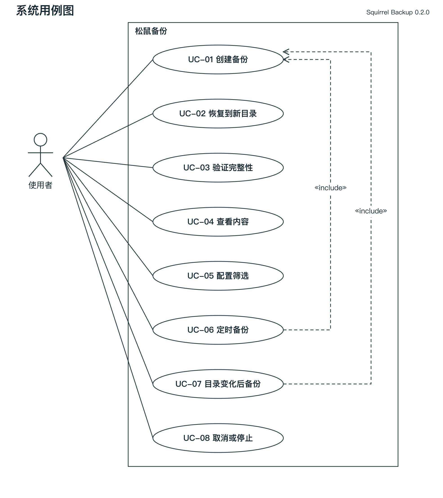
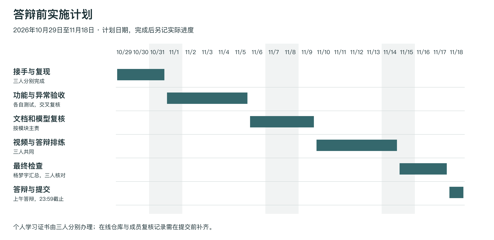

# 松鼠备份需求分析说明书

版本 0.2.0。本文依据《软件开发综合实验》的实验要求、讲义和报告模板，定义 macOS 本地备份软件当前范围，作为设计、编码、测试和验收的共同基线。优先级以数据正确性、原文件保护、操作易用性和扩展功能完整性为序。

## 1 任务概述

### 1.1 引言

学生需要把一个目录树保存到独立备份文件，并在另一个位置恢复，解决实验资料、课程代码和个人文件的离线副本管理问题。项目以面向对象的软件工程方法推进，交付源码、可执行应用、构建脚本、需求分析、系统设计和软件测试文档。用例、类、构件、顺序和状态模型随项目提供，模型元素按当前源码命名。

### 1.2 综合描述

产品是新建的独立单机应用，名称为松鼠备份。系统不依赖远端服务器或账号，包含 Cocoa GUI 与 CLI 两个入口，两者调用相同 C++ 核心。核心功能是扫描文件树、筛选、打包、可选压缩和加密、校验及恢复。自动任务在同一进程中运行，包含定时快照、轮询变化检测和任务内保留策略。

普通用户主要使用 GUI 选择路径和密码；熟悉终端的用户通过 CLI 设置完整筛选条件和自动任务；开发和验收人员使用测试脚本检查正确性。无需登录产品账号，访问范围由当前 macOS 用户的文件权限决定。

### 1.3 运行环境

本轮复核宿主为 macOS 13.0、arm64、Apple Clang 14.0.3、Command Line Tools；0.2.0 的部署目标统一为 macOS 13.0。原0.1.0报告记录的平台不作为本轮实测环境，其他系统版本和机器仍需实测。使用本机磁盘，目标父目录必须存在。建议测试时预留原始数据数倍的可用空间，因为打包、加密和恢复暂存会产生中间文件。

标准构建需要 clang++、SDK 和 make；GoogleTest 仅用于测试。普通使用不需要 Python。文档生成和黑盒测试使用 Python 开发工具，不参与备份后端。软件不需要网络；首次获取开发依赖可能需要网络。

## 2 功能需求

### 2.1 功能划分与唯一编号

| 编号 | 功能及约束 | 验收标准 |
| --- | --- | --- |
| FR-01 | 目录树备份 | 普通文件二进制内容、层级和空目录可备份；输出在源树之外 |
| FR-02 | 安全恢复 | 只恢复到新目录；哈希一致；失败不覆盖已有路径 |
| FR-03 | 特殊文件 | 保留软链接目标字符串、硬链接关系和 FIFO 类型；不读取 FIFO 内容 |
| FR-04 | 基础元数据 | 记录权限、UID/GID、atime/mtime纳秒时间、xattrs；无法恢复属主/xattrs时警告，权限/时间恢复失败则报错 |
| FR-05 | 路径筛选 | 相对路径通配符匹配；目录结构保留 |
| FR-06 | 类型筛选 | f/l/p 选择文件、软链接和管道；硬链接按普通文件筛选 |
| FR-07 | 名字筛选 | 文件基名通配符匹配 |
| FR-08 | 时间筛选 | 按 mtime 秒级上下界筛选，含边界 |
| FR-09 | 尺寸筛选 | 普通文件字节数含上下界，0 字节允许 |
| FR-10 | 用户筛选 | 按数值 UID 筛选非目录条目 |
| FR-11 | 排除规则 | 多条规则匹配路径或基名，匹配目录后剪枝 |
| FR-12 | 自定义打包 | 所有数据及元数据保存在单个 .sqbk 文件，不调用 tar/zip |
| FR-13 | Huffman 压缩 | 每块最大 1 MiB，无损；压缩收益不足则保存原始块 |
| FR-14 | 密码加密 | AES-256-CBC 加密与 HMAC 校验，随机盐和 IV，错误密码失败 |
| FR-15 | 完整性验证 | 检查外层摘要及内部记录、边界、压缩流、结束标志 |
| FR-16 | 内容查看 | CLI显示条目、类型和尺寸；GUI显示条目、类型与汇总；加密备份须提供密码 |
| FR-17 | 图形界面 | 三个页面提供创建、恢复验证、自动任务；耗时工作不在主线程执行 |
| FR-18 | 定时备份 | 启动立即备份，之后按正整数秒间隔串行生成完整快照 |
| FR-19 | 数据淘汰 | 任务保留最新 N 份，只删除本次任务生成且已登记的文件；删除失败警告，可能暂超保留上限 |
| FR-20 | 实时备份 | 按轮询周期扫描元数据，连续两次观察稳定变化后生成新快照 |
| FR-21 | 任务停止与退出 | SIGINT/SIGTERM 或 GUI 停止按钮请求停止；在扫描、数据块处理和发布前检查取消；清理未完成结果后退出；GUI关闭/退出等待清理完成 |
| FR-22 | 界面参数记忆 | 保存白名单内的路径、筛选、间隔、份数及开关；密码不保存，重新启动不自动启动任务 |
| FR-23 | 发布前源目录复查 | 打包后新增、删除或元数据变化时拒绝发布；保留已有备份 |
| FR-24 | 进度与取消反馈 | 展示当前阶段与路径；单次任务可取消，已发布结果不回滚 |

当前不包含网盘服务、用户管理、网络传输、增量、系统守护进程、设备节点、socket、ACL、文件 flags 或备份浏览器中的单文件提取。遇到不支持的特殊类型会失败并明确提示，不静默丢失。

### 2.2 系统用例

用例 UC-01 创建备份。参与者为本机用户，触发为点击“开始备份”或输入 backup 命令。前置条件是源为可读目录、输出父目录可写、输出路径不存在且位于源树之外。基本流程：收集路径和选项，校验参数，扫描并筛选，记录元数据，自定义打包并按块压缩，封装加密或摘要，刷写备份文件，以不覆盖方式发布输出。成功后产生完整 .sqbk 文件及摘要统计。源文件变化、磁盘不足、权限错误等均以失败结束，既有输出不受影响。

用例 UC-02 恢复备份。参与者为本机用户。前置条件是备份可读，目标父目录可写，目标路径尚不存在。基本流程：验证格式和摘要／认证标签，解密至私有目录，校验记录并恢复数据、特殊文件及文件元数据，检查结束标志后逆序恢复目录元数据，最后独占重命名发布目录。错误密码、损坏、越界或非法路径中止操作，不发布目标目录。不能写入新目录时保留原备份。

用例 UC-03 验证完整性。前置条件是备份可读；加密文件需提供密码。系统验证外层认证与全部内部记录，成功返回统计；格式、密码或完整性失败返回错误。操作不修改用户源数据和恢复目录，但会创建并清理私有临时文件。

用例 UC-04 查看内容。前置条件同 UC-03。系统先完成验证，再显示条目和类型，CLI另列条目尺寸，GUI显示汇总；验证失败不显示成功清单。GUI 对超长列表限制显示数量，完整清单可通过 CLI list 获取。

用例 UC-05 配置筛选。用户在创建备份前设置路径、类型、名字、时间、尺寸、UID及排除规则；完整选项由CLI提供，GUI提供常用子集。系统先判断排除，再对非目录条目应用 AND 条件，目录保留以满足树结构；选定硬链接的首次出现保存数据，之后只保存关系。非法范围拒绝。成功后只有满足组合条件的条目进入备份；更改配置本身不会启动备份。

用例 UC-06 启动定时任务。前置条件是源目录可读、已有存储目录位于源树外，周期和保留份数有效。系统创建本次独立任务目录并立即备份，之后按周期生成快照，成功后淘汰超额旧快照；失败记录错误并重试，不淘汰上次成功快照。停止请求取消尚未完成的快照；清理后退出，已发布快照保留。

用例 UC-07 启动实时任务。前置条件同 UC-06。系统立即备份，然后轮询被筛选目录的元数据；发现变化后等待下一次观察确认稳定，再执行备份。持续变化时继续等待；任务失败会重试。停止后的后置条件同 UC-06。不承诺内核事件级延迟或事务级文件系统一致性。

用例 UC-08 取消操作或停止自动任务。前置条件是存在正在运行的操作。用户点击取消或停止，或 CLI 接收 SIGINT/SIGTERM 后设置停止标志。等待阶段以 100 ms 间隔检查；扫描、编解码和加密在工作单元之间检查。收到请求后抛出专用取消异常并清理私有暂存，不发布未完成结果。GUI 显示“已取消”或任务“已停止”，恢复输入控件。发布是不可分割的提交点，取消不会删除已经成功发布的备份。关闭窗口或退出应用先提出取消请求，完成清理后再关闭。

模型文件位于 docs/uml/SquirrelBackup.mdj；用例编号与上述描述一致。

## 3 外部接口需求

### 3.1 用户界面

GUI 采用 macOS 文件选择器、路径输入框、压缩和加密选项、密码框、动作按钮、状态指示和滚动日志。创建、恢复与自动任务分页面显示。密码不回显到日志。0.2.0 使用本机偏好设置保存14项明确列出的表单字段，密码字段不在其中；恢复这些参数不会自动启动任务。执行期间禁用新的业务动作，避免并行写同一任务；错误以日志和状态栏提示。CLI 成功返回 0，普通失败返回 1，单次操作被取消返回 130；自动任务正常停止返回 0。进度写 stderr，结果写 stdout。文件名含换行时 CLI list 使用引号和转义显示。

### 3.2 硬件接口

通过操作系统文件系统接口读写本地存储，无自定义硬件协议。软件不直接访问块设备，不要求管理员权限。外置卷的元数据能力和授权不属于当前实测范围。

### 3.3 软件接口

核心公开头文件为 include/squirrel/backup.h。BackupService 提供 backup、inspect、restore；Scheduler 提供 run。运行时依赖 C++ 标准库、POSIX、Cocoa 和 CommonCrypto/Security。自定义文件格式版本固定为 1，未知版本拒绝；不承诺与 tar、Time Machine 等其他格式互通。

## 4 其它非功能性需求

正确性 NFR-01：测试数据恢复后的 SHA256 应与源一致；空目录和特殊文件结构正确。安全性 NFR-02：拒绝绝对路径、父路径跳转、重复路径、非目录父节点和非法硬链接，且备份和恢复不覆盖已有目标。可维护性 NFR-03：算法、文件扫描、格式、封装、调度和 UI 分离，避免复制两套业务逻辑。

资源 NFR-04：普通文件按 1 MiB 块处理，内存还包含全量条目与元数据列表，不宣称总体常量内存。格式设定单文件 1 TiB、条目数 100 万、文本字段 64 KiB、每条目 xattrs 总计 64 MiB 的上限；这些是防御性边界，不是已完成的容量测试指标。性能 NFR-05：提供本机实测时间、输入输出大小和哈希比对结果，不把缓存条件下的测量作为吞吐承诺。

健壮性 NFR-06：采用私有暂存目录和不覆盖发布，磁盘不足、截断、密码错误应给出错误。源文件变化检测基于大小、device/inode、mtime和ctime纳秒值的前后对比，并在发布前重新扫描选定目录树，不能等同于 APFS 一致性快照。系统断电或强制 kill 后可能遗留临时目录，不保证安全擦除或电源故障后的持久性。需要多文件一致性时，应先暂停源目录的写入，或先取得系统快照再归档；运行中的数据库等数据不在当前一致性保证范围。

## 5 项目规划

### 5.1 人员分工

第3组组长杨梦宇（2023150901002）负责扫描、筛选、安全恢复与 CLI；郭畅（2023040904017）负责归档协议、Huffman 与密码封装；李想（2023150901012）负责原生界面、自动任务和集成发布。每人还承担对应测试、建模、文档和演示，按30个相对工作量点均衡安排。任务点是后续分工尺度，不是已经发生的工时或历史贡献比例。具体交付标准见三人分工方案。

### 5.2 总体规划

已有代码和自动测试作为接手基线。以下为2026年10月29日起至答辩前的计划，实际完成时间应由成员根据提交和复核记录更新。

| 阶段 | 计划日期 | 主责与交付 |
| --- | --- | --- |
| 接手与复现 | 10月29日至10月31日 | 三人分别构建、阅读并复现主责模块 |
| 功能与异常验收 | 11月1日至11月5日 | 各自执行模块用例并交叉复核；李想汇总GUI人工验收 |
| 文档和模型复核 | 11月6日至11月9日 | 杨梦宇核对需求，郭畅核对算法和格式，李想核对动态流程 |
| 视频与答辩排练 | 11月10日至11月14日 | 三人共同演示和互问，核对程序、报告、PPT版本 |
| 最终检查与提交准备 | 11月15日至11月17日 | 组长汇总，三人核对身份、学习证书、文件命名和可运行性 |
| 答辩与提交 | 11月18日 | 上午答辩；当日23:59前由组长提交小组材料 |

公开仓库：https://github.com/Peregrinate-PG/SquirrelBackup。2026年10月29日上传真实Git历史，并经匿名克隆核对源码与提交。后续协作保留实际记录；Teambition等看板属于鼓励项。每位成员的AI学习证书另行提交。
