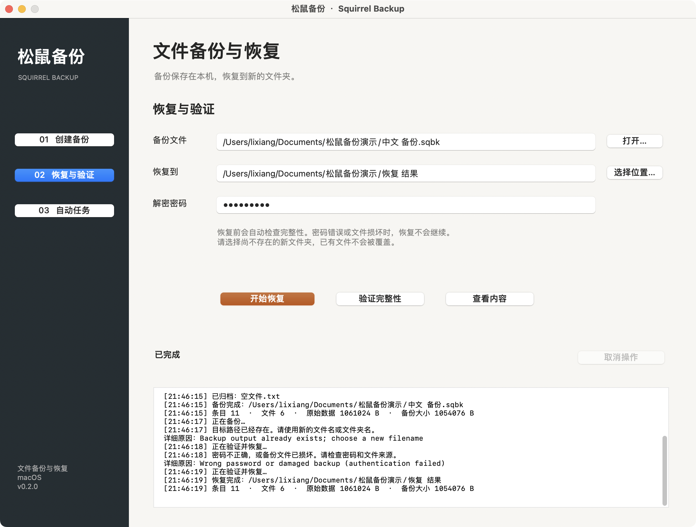

# 松鼠备份软件测试报告

版本 0.2.0。整理时间 2026年10月29日 21:54（北京时间）。本轮命名测试 97 项，通过 97 项。结果来自可复现的测试程序及其 XML、JSON 和日志。GUI 内部断言、桌面验收与核心用例分别统计。

## 1 测试环境与方法

测试宿主为 macOS 13.0 arm64，编译器为 Apple clang version 14.0.3 (clang-1403.0.22.14.1)。业务代码使用C++17；测试工具包括GoogleTest、Python、AddressSanitizer和UndefinedBehaviorSanitizer。

所有源目录、备份与恢复目标都在测试临时目录内。普通文件用完整字节或SHA256比较；链接用目标字符串和inode关系检查；FIFO只检查类型；元数据按权限、时间和扩展属性逐项比对。测试由随包脚本执行，用例名称和原始输出一并保留。

| 类型 | 用例数量 | 通过数量 | 原始证据 |
| --- | --- | --- | --- |
| 单元 | 52 | 52 | test-results/unit.xml |
| CLI集成 | 21 | 21 | test-results/integration.json |
| 异常归档与并发 | 18 | 18 | test-results/security.json |
| 工作流回归 | 6 | 6 | test-results/workflow-regression.json |

命名用例逐项清单见 test-results/test-matrix.csv。参数化取消测试按不同阶段分别统计；Sanitizer再次运行同一用例不额外计数。

## 2 关键功能与异常用例

下表给出输入、操作和可判断的预期结果。版本与日期同报告首页；实际结果“通过”只表示相应自动断言成立。更详细的准备步骤可直接在tests目录对应函数中复现。

| 编号与检查项 | 输入和操作步骤 | 预期及实际结果 |
| --- | --- | --- |
| T01 目录树往返 | 中文名、空文件、空目录和跨块文件；备份后恢复到新目录 | 内容逐字节一致，层级完整；通过 |
| T02 原始块模式 | 关闭压缩；备份并恢复同一文件树 | 无需压缩仍可恢复；通过 |
| T03 加密往返 | 使用测试密码创建备份，再以正确密码恢复 | 认证成功且内容一致；通过 |
| T04 错误密码 | 用另一密码恢复加密备份 | 认证失败，目标目录不存在；通过 |
| T05 篡改与截断 | 更改归档字节或截去尾部，再验证和恢复 | 完整性检查拒绝损坏文件；通过 |
| T06 不覆盖备份 | 预先创建目标文件，再执行backup | 拒绝发布，原文件内容不变；通过 |
| T07 不覆盖恢复 | 目标目录内放入保留文件，再执行restore | 拒绝恢复，保留文件不变；通过 |
| T08 特殊文件 | 建立软链接、断链、硬链接与FIFO，备份后恢复 | 链接目标和inode关系正确，FIFO类型保留；通过 |
| T09 元数据 | 设定0640权限、固定纳秒时间和user.squirrel属性 | 恢复权限、时间及属性值符合断言；通过 |
| T10 只读目录 | 根目录设为只读，备份后恢复 | 可发布结果且最终目录仍为原权限；通过 |
| T11 排除剪枝 | 源树含nested子目录；设置排除规则 | 整个被排除子树不进入备份；通过 |
| T12 六类筛选 | 分别设置路径、名字、类型、时间、大小、UID条件 | 仅选入满足条件的非目录条目；通过 |
| T13 Huffman边界 | 空、单符号、全字节取值、随机与1MiB输入，编码后解码 | 字节一致，畸形频数和尾随数据被拒绝；通过 |
| T14 保留数量 | 定时生成3份快照，keep=2；存储目录预置无关文件 | 只保留本任务最新2份，无关文件不变；通过 |
| T15 变化检测 | watch运行后依次新建、改名、删除文件 | 稳定变化生成新快照，恢复状态对应变化；通过 |
| T16 保留mtime改写 | 改写同尺寸文件并恢复mtime；保持其它时间观测 | ctime变化可触发快照；通过 |
| T17 无变化等待 | 启动watch后保持源树不变 | 不重复生成相同状态快照；通过 |
| T18 任务参数 | 输入小数间隔、短密码、反向范围或文件源路径 | 启动前拒绝无效配置，不进入无限重试；通过 |
| T19 路径防护 | 构造外层摘要正确、内部含父目录跳转等非法路径的备份 | 解析器拒绝，未向目标外写文件；通过 |
| T20 并发发布 | 两个进程向同一路径同时创建备份 | 仅一个成功，最终文件可验证；通过 |
| T21 各阶段取消备份 | 在扫描、打包、封装、源目录复查、发布前请求取消 | 5种情况均不发布目标并清理暂存；通过 |
| T22 各阶段取消恢复 | 在认证、解码、读取、元数据、发布前请求取消 | 5种情况均不发布恢复目录且保留原备份；通过 |
| T23 发布前变化 | 打包后分别新增、删除文件或更改元数据 | 复查拒绝发生变化的目录树；通过 |
| T24 取消自动快照 | 先完成一份快照，再取消下一份 | 保留上一份完整快照，不留下半成品；通过 |
| T25 清理边界 | 暂存中包含不可读目录和指向外部的符号链接 | 能清理自身目录，不跟随链接清理外部路径；通过 |
| T26 淘汰失败 | 让旧快照路径无法删除，并限定成功次数 | 记录警告；不额外创建快照、不绕过max_runs；通过 |

上述T编号是报告场景编号，可能对应一项或多项命名测试，不能再与总用例数相加。

## 3 原生界面验证

后台AppKit测试通过 53 项内部断言，覆盖输入校验、密码字段、设置白名单、忙碌状态、加密备份、错误密码、恢复、内容查看、验证、保留数量、停止、取消、关闭和退出请求。界面状态和事件日志从真实应用生成，未用设计稿代替运行结果。

另在李想的Mac上通过系统辅助功能和鼠标、键盘事件执行12项桌面验收，覆盖六个文件选择器的选择与取消、中文空格路径、拒绝覆盖、错误密码、定时保留、变化检测及运行中停止。备份中关闭窗口和恢复中退出均完成清理后结束进程；重启恢复参数，不保存密码，也不自动启动任务。此项使用普通发布应用，未进入内部自测模式。

错误密码时显示中文原因并拒绝发布恢复目录；取消后恢复输入状态并清理暂存。桌面验收结果见test-results/gui-desktop-acceptance.json，截图位于docs/screenshots/desktop。恢复核对排除系统自动维护的com.apple.macl与com.apple.provenance；用户扩展属性仍严格比较。验收工具另通过13项正反例检查。

## 4 编译检查与动态内存检查

业务代码以-Wall -Wextra -Wpedantic -Werror编译通过。CommonCrypto系统接口的弃用告警按项目构建选项单独处理。make sanitize以AddressSanitizer与UndefinedBehaviorSanitizer运行相同的 97 项测试，未报告错误，原始日志为test-results/sanitize-020.log。

这两类工具不覆盖所有数据竞争、系统资源泄漏和断电场景。工具未覆盖的情形继续保留为验证边界。

操作系统信号补充测试通过20/20种组合：向正在读写的明文／加密backup、restore、verify、list进程发送SIGINT或SIGTERM，单次操作均返回130且清理暂存；定时与watch任务在下一份备份进行中停止，返回0并保留前一份可验证快照。源文件和原归档哈希未变。证据为signals-020.json，独立于核心命名用例统计。

cpplint 2.0.2检查结果：通过。范围为Makefile列出的C++头文件、业务源码与测试，未包含Objective-C++；原始日志见lint-020.log。

Huffman随机输入测试运行60.0秒、32353次，结果通过，固定种子20261029。它是随机输入驱动，并非覆盖率引导的libFuzzer；使用ASan/UBSan，次数不计入命名用例总数。证据为fuzz.json及fuzz.log。

归档解析器使用LLVM libFuzzer 14.0.6进行覆盖率引导测试，运行602.286秒、119,844次，通过。进程正常退出，没有崩溃工件或ASan/UBSan错误标记。归档与Huffman相关源码哈希与本次源码一致。测试使用空恢复目标，范围为SQTREE解析与Huffman解码，不含文件写入、加密封装和GUI。执行次数不并入97项用例，也不代表覆盖百分比。复现方法见test-results/archive-fuzz-020.md，原始JSON和日志同名保存。

## 5 性能与兼容性

单次本地测量如下。备份和恢复时间包含CLI进程开销，测量期间存在其它后台任务，文件系统缓存也可能影响结果；不据此给出稳定吞吐率承诺。

| 数据集 | 输入字节 | 归档字节 | 备份秒 | 恢复秒 | SHA256 |
| --- | --- | --- | --- | --- | --- |
| 重复单字节 | 33554432 | 33356 | 0.9400 | 0.0194 | 一致 |
| 随机数据 | 8388608 | 8388980 | 0.2021 | 0.0466 | 一致 |

重复单字节数据主要覆盖Huffman单符号分支；随机数据主要验证压缩无收益时回退原始块。这里没有测峰值RSS，格式中的1TiB单文件上限也不等于已完成该容量实测。

0.1.0与0.2.0之间的双向恢复已检查明文和加密共4种组合，均通过内容与链接关系比对。测试时间2026年10月29日 11:36（北京时间），见compatibility-020.json。这些兼容性场景单独列出，不并入核心命名用例总数。

写入故障与强制终止另行补测24种场景，通过24种。明文和加密分别检查打包、封装、解码、恢复写入返回ENOSPC，刷写或发布失败，权限恢复失败，以及EINTR和短写入。失败场景没有发布目标，已保存备份保持不变，同名目标重试成功。4种实际SIGKILL场景在观察到至少4MiB写入后强制结束，私有暂存根目录以0700权限遗留，正常重试不删除旧暂存。详细范围、源码和原始记录见test-results/fault-injection-020.md及对应JSON；没有实际占满磁盘或断电，不并入97项核心用例。

## 6 持续运行测试

第一次持续运行在52次正常检查后中断，最后记录时长为4.34小时。核对时原进程已不存在，退出原因尚未确定。该次不认定20小时通过，也不与后续运行时长相加；观察记录见soak-interrupted-20261029.json。

后一次定时与加密watch联合观察从2026年10月29日15:22开始，最后有效检查覆盖5.76小时，共69次，记录中无错误。此后取消连续20小时测试安排，核对时进程已经结束，未再重启；不能据此认定20小时通过。课程材料没有连续20小时测试要求，本次保留观察记录，不再作为交付前置条件。原始记录及取消说明见soak-observation-20261029.raw.json与soak-cancelled-20261029.json。

观察使用冻结CLI，二进制对应关系见lint-rebuild-comparison.json。

## 7 结论和验收边界

已覆盖的备份、验证、恢复、取消和自动任务路径均满足对应断言。发布前复查能发现已测的源树变化，但不能提供多文件事务一致性；应用不支持网络备份、增量备份、系统守护和重启后自动续跑。

本轮未覆盖跨机器运行、外置卷和网络卷、真实磁盘耗尽、掉电持久性、异属主恢复、ACL与文件flags。强制终止只验证了补测中列出的时机和输入；未实现的功能不作为本轮通过项。

复现命令见README：make test、make sanitize及tests/benchmark.py。GUI自测使用--self-test，长测脚本为tests/soak.py；两者均使用新的测试目录，不使用工作数据。
