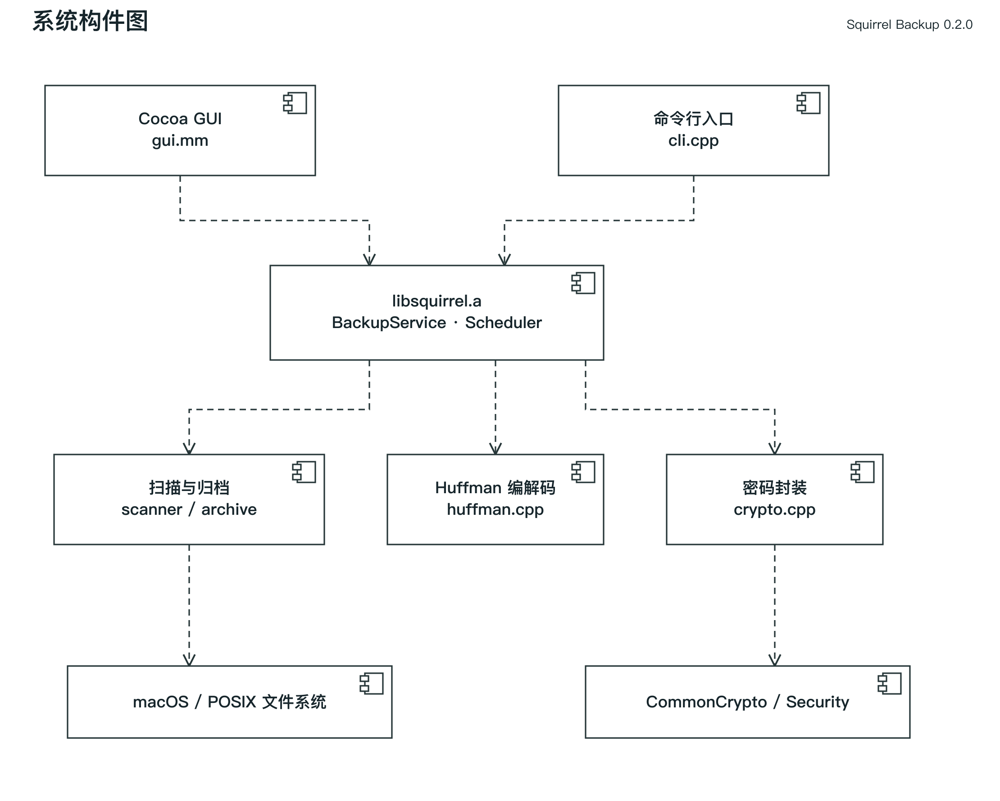
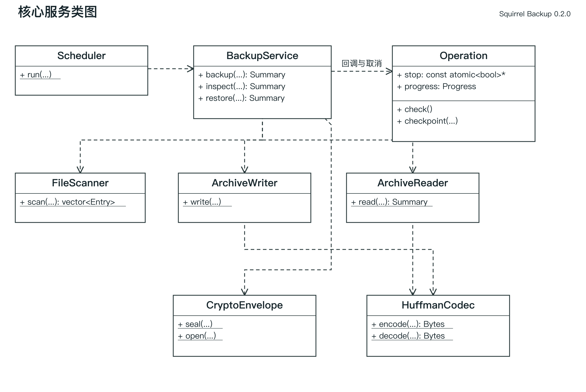
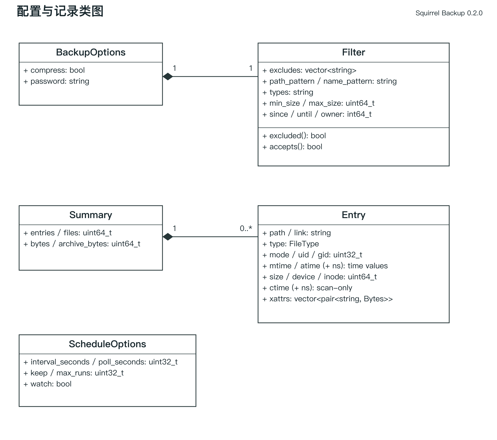
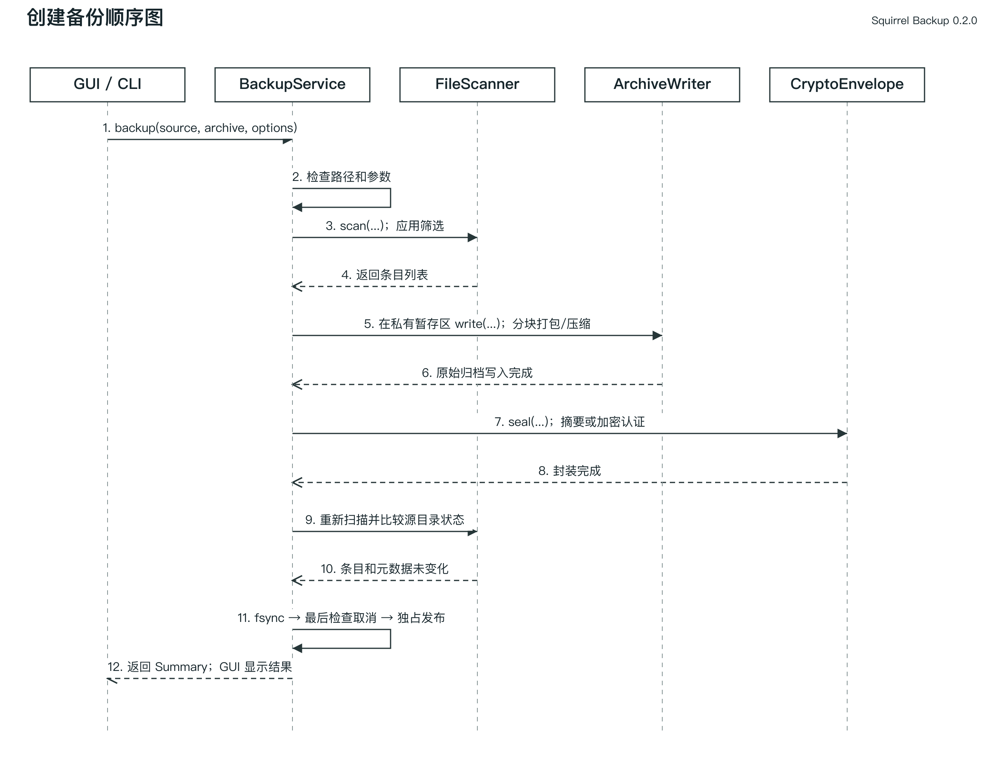
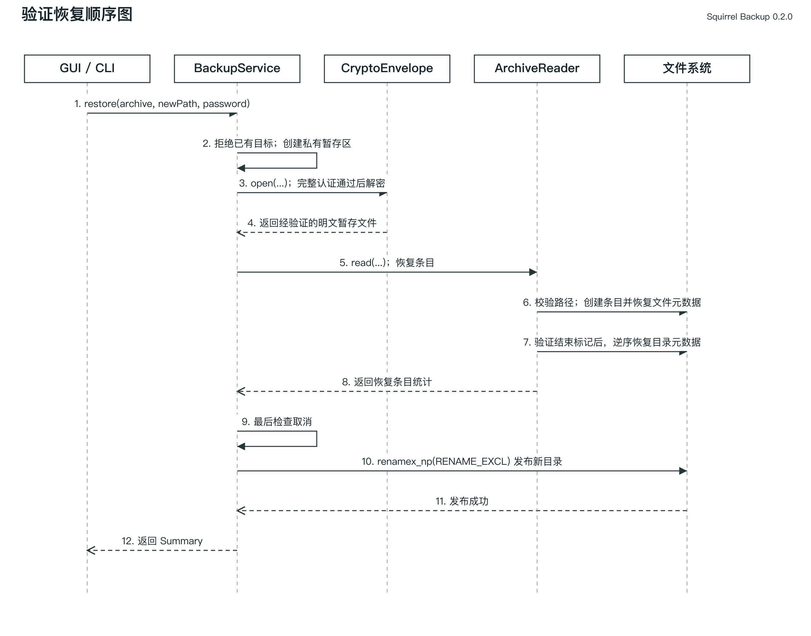
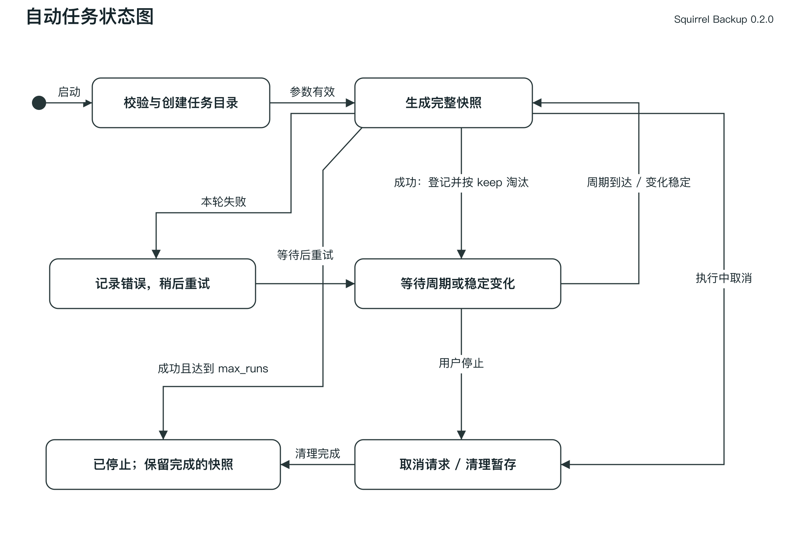
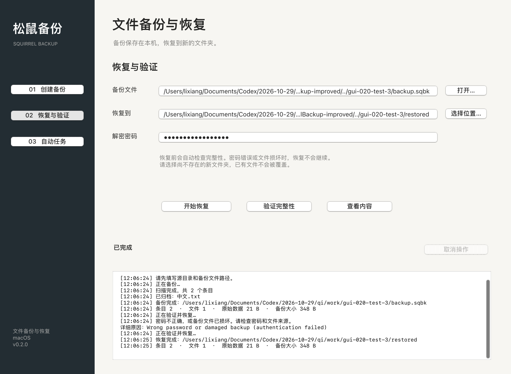

# 软件开发综合实验小组报告

电子科技大学 计算机科学与工程学院 · 第3组 · 松鼠备份0.2.0

组长：杨梦宇 2023150901002；组员：郭畅 2023040904017、李想 2023150901012。

本阅读稿与课程Word报告共用需求、设计、测试和总结正文；封面、原表格和教师评分栏保留在Word版本。个人职责与技术复核稿供本人确认。

## 一 实验室名称

________________（按实际填写）

## 二 实验项目名称

文件备份软件 松鼠备份 Squirrel Backup。

## 三 实验目的

综合运用C/C++、数据结构、软件工程和操作系统文件接口，完成需求分析、设计、实现、测试与发布。练习文件树表示、自定义格式、无损压缩、密码封装和资源管理，并用实际结果核对需求。

## 四 实验内容

实现macOS单机备份与恢复，提供GUI和CLI，共用C++业务核心。选做功能包括软硬链接、FIFO、基础元数据、六类筛选、打包压缩、密码加密、定时、变化检测和任务内保留策略。网络备份、增量备份与系统守护未实现。系统密码库和Cocoa的使用如实说明，不将库算法申报为自研。

## 五 实验器材

macOS13.0、Apple Silicon、Apple Clang14.0.3、Command Line Tools、make、git、GoogleTest与Python；Cocoa/AppKit用于GUI。StarUML7.1.1用于模型读取与导出校验。

## 六 实验步骤及操作

## 松鼠备份需求分析说明书

版本 0.2.0。本文依据《软件开发综合实验》的实验要求、讲义和报告模板，定义 macOS 本地备份软件当前范围，作为设计、编码、测试和验收的共同基线。优先级以数据正确性、原文件保护、操作易用性和扩展功能完整性为序。

### 1 任务概述

#### 1.1 引言

学生需要把一个目录树保存到独立备份文件，并在另一个位置恢复，解决实验资料、课程代码和个人文件的离线副本管理问题。项目以面向对象的软件工程方法推进，交付源码、可执行应用、构建脚本、需求分析、系统设计和软件测试文档。用例、类、构件、顺序和状态模型随项目提供，模型元素按当前源码命名。

#### 1.2 综合描述

产品是新建的独立单机应用，名称为松鼠备份。系统不依赖远端服务器或账号，包含 Cocoa GUI 与 CLI 两个入口，两者调用相同 C++ 核心。核心功能是扫描文件树、筛选、打包、可选压缩和加密、校验及恢复。自动任务在同一进程中运行，包含定时快照、轮询变化检测和任务内保留策略。

普通用户主要使用 GUI 选择路径和密码；熟悉终端的用户通过 CLI 设置完整筛选条件和自动任务；开发和验收人员使用测试脚本检查正确性。无需登录产品账号，访问范围由当前 macOS 用户的文件权限决定。

#### 1.3 运行环境

本轮复核宿主为 macOS 13.0、arm64、Apple Clang 14.0.3、Command Line Tools；0.2.0 的部署目标统一为 macOS 13.0。原0.1.0报告记录的平台不作为本轮实测环境，其他系统版本和机器仍需实测。使用本机磁盘，目标父目录必须存在。建议测试时预留原始数据数倍的可用空间，因为打包、加密和恢复暂存会产生中间文件。

标准构建需要 clang++、SDK 和 make；GoogleTest 仅用于测试。普通使用不需要 Python。文档生成和黑盒测试使用 Python 开发工具，不参与备份后端。软件不需要网络；首次获取开发依赖可能需要网络。

### 2 功能需求

#### 2.1 功能划分与唯一编号

| 编号 | 功能及约束 | 验收标准 |
| --- | --- | --- |
| FR-01 | 目录树备份 | 普通文件二进制内容、层级和空目录可备份；输出在源树之外 |
| FR-02 | 安全恢复 | 只恢复到新目录；哈希一致；失败不覆盖已有路径 |
| FR-03 | 特殊文件 | 保留软链接目标字符串、硬链接关系和 FIFO 类型；不读取 FIFO 内容 |
| FR-04 | 基础元数据 | 记录权限、UID/GID、atime/mtime纳秒时间、xattrs；无法恢复属主/xattrs时警告，权限/时间恢复失败则报错 |
| FR-05 | 路径筛选 | 相对路径通配符匹配；目录结构保留 |
| FR-06 | 类型筛选 | f/l/p 选择文件、软链接和管道；硬链接按普通文件筛选 |
| FR-07 | 名字筛选 | 文件基名通配符匹配 |
| FR-08 | 时间筛选 | 按 mtime 秒级上下界筛选，含边界 |
| FR-09 | 尺寸筛选 | 普通文件字节数含上下界，0 字节允许 |
| FR-10 | 用户筛选 | 按数值 UID 筛选非目录条目 |
| FR-11 | 排除规则 | 多条规则匹配路径或基名，匹配目录后剪枝 |
| FR-12 | 自定义打包 | 所有数据及元数据保存在单个 .sqbk 文件，不调用 tar/zip |
| FR-13 | Huffman 压缩 | 每块最大 1 MiB，无损；压缩收益不足则保存原始块 |
| FR-14 | 密码加密 | AES-256-CBC 加密与 HMAC 校验，随机盐和 IV，错误密码失败 |
| FR-15 | 完整性验证 | 检查外层摘要及内部记录、边界、压缩流、结束标志 |
| FR-16 | 内容查看 | CLI显示条目、类型和尺寸；GUI显示条目、类型与汇总；加密备份须提供密码 |
| FR-17 | 图形界面 | 三个页面提供创建、恢复验证、自动任务；耗时工作不在主线程执行 |
| FR-18 | 定时备份 | 启动立即备份，之后按正整数秒间隔串行生成完整快照 |
| FR-19 | 数据淘汰 | 任务保留最新 N 份，只删除本次任务生成且已登记的文件；删除失败警告，可能暂超保留上限 |
| FR-20 | 实时备份 | 按轮询周期扫描元数据，连续两次观察稳定变化后生成新快照 |
| FR-21 | 任务停止与退出 | SIGINT/SIGTERM 或 GUI 停止按钮请求停止；在扫描、数据块处理和发布前检查取消；清理未完成结果后退出；GUI关闭/退出等待清理完成 |
| FR-22 | 界面参数记忆 | 保存白名单内的路径、筛选、间隔、份数及开关；密码不保存，重新启动不自动启动任务 |
| FR-23 | 发布前源目录复查 | 打包后新增、删除或元数据变化时拒绝发布；保留已有备份 |
| FR-24 | 进度与取消反馈 | 展示当前阶段与路径；单次任务可取消，已发布结果不回滚 |

当前不包含网盘服务、用户管理、网络传输、增量、系统守护进程、设备节点、socket、ACL、文件 flags 或备份浏览器中的单文件提取。遇到不支持的特殊类型会失败并明确提示，不静默丢失。

#### 2.2 系统用例

用例 UC-01 创建备份。参与者为本机用户，触发为点击“开始备份”或输入 backup 命令。前置条件是源为可读目录、输出父目录可写、输出路径不存在且位于源树之外。基本流程：收集路径和选项，校验参数，扫描并筛选，记录元数据，自定义打包并按块压缩，封装加密或摘要，刷写备份文件，以不覆盖方式发布输出。成功后产生完整 .sqbk 文件及摘要统计。源文件变化、磁盘不足、权限错误等均以失败结束，既有输出不受影响。

用例 UC-02 恢复备份。参与者为本机用户。前置条件是备份可读，目标父目录可写，目标路径尚不存在。基本流程：验证格式和摘要／认证标签，解密至私有目录，校验记录并恢复数据、特殊文件及文件元数据，检查结束标志后逆序恢复目录元数据，最后独占重命名发布目录。错误密码、损坏、越界或非法路径中止操作，不发布目标目录。不能写入新目录时保留原备份。

用例 UC-03 验证完整性。前置条件是备份可读；加密文件需提供密码。系统验证外层认证与全部内部记录，成功返回统计；格式、密码或完整性失败返回错误。操作不修改用户源数据和恢复目录，但会创建并清理私有临时文件。

用例 UC-04 查看内容。前置条件同 UC-03。系统先完成验证，再显示条目和类型，CLI另列条目尺寸，GUI显示汇总；验证失败不显示成功清单。GUI 对超长列表限制显示数量，完整清单可通过 CLI list 获取。

用例 UC-05 配置筛选。用户在创建备份前设置路径、类型、名字、时间、尺寸、UID及排除规则；完整选项由CLI提供，GUI提供常用子集。系统先判断排除，再对非目录条目应用 AND 条件，目录保留以满足树结构；选定硬链接的首次出现保存数据，之后只保存关系。非法范围拒绝。成功后只有满足组合条件的条目进入备份；更改配置本身不会启动备份。

用例 UC-06 启动定时任务。前置条件是源目录可读、已有存储目录位于源树外，周期和保留份数有效。系统创建本次独立任务目录并立即备份，之后按周期生成快照，成功后淘汰超额旧快照；失败记录错误并重试，不淘汰上次成功快照。停止请求取消尚未完成的快照；清理后退出，已发布快照保留。

用例 UC-07 启动实时任务。前置条件同 UC-06。系统立即备份，然后轮询被筛选目录的元数据；发现变化后等待下一次观察确认稳定，再执行备份。持续变化时继续等待；任务失败会重试。停止后的后置条件同 UC-06。不承诺内核事件级延迟或事务级文件系统一致性。

用例 UC-08 取消操作或停止自动任务。前置条件是存在正在运行的操作。用户点击取消或停止，或 CLI 接收 SIGINT/SIGTERM 后设置停止标志。等待阶段以 100 ms 间隔检查；扫描、编解码和加密在工作单元之间检查。收到请求后抛出专用取消异常并清理私有暂存，不发布未完成结果。GUI 显示“已取消”或任务“已停止”，恢复输入控件。发布是不可分割的提交点，取消不会删除已经成功发布的备份。关闭窗口或退出应用先提出取消请求，完成清理后再关闭。

模型文件位于 docs/uml/SquirrelBackup.mdj；用例编号与上述描述一致。

### 3 外部接口需求

#### 3.1 用户界面

GUI 采用 macOS 文件选择器、路径输入框、压缩和加密选项、密码框、动作按钮、状态指示和滚动日志。创建、恢复与自动任务分页面显示。密码不回显到日志。0.2.0 使用本机偏好设置保存14项明确列出的表单字段，密码字段不在其中；恢复这些参数不会自动启动任务。执行期间禁用新的业务动作，避免并行写同一任务；错误以日志和状态栏提示。CLI 成功返回 0，普通失败返回 1，单次操作被取消返回 130；自动任务正常停止返回 0。进度写 stderr，结果写 stdout。文件名含换行时 CLI list 使用引号和转义显示。

#### 3.2 硬件接口

通过操作系统文件系统接口读写本地存储，无自定义硬件协议。软件不直接访问块设备，不要求管理员权限。外置卷的元数据能力和授权不属于当前实测范围。

#### 3.3 软件接口

核心公开头文件为 include/squirrel/backup.h。BackupService 提供 backup、inspect、restore；Scheduler 提供 run。运行时依赖 C++ 标准库、POSIX、Cocoa 和 CommonCrypto/Security。自定义文件格式版本固定为 1，未知版本拒绝；不承诺与 tar、Time Machine 等其他格式互通。

### 4 其它非功能性需求

正确性 NFR-01：测试数据恢复后的 SHA256 应与源一致；空目录和特殊文件结构正确。安全性 NFR-02：拒绝绝对路径、父路径跳转、重复路径、非目录父节点和非法硬链接，且备份和恢复不覆盖已有目标。可维护性 NFR-03：算法、文件扫描、格式、封装、调度和 UI 分离，避免复制两套业务逻辑。

资源 NFR-04：普通文件按 1 MiB 块处理，内存还包含全量条目与元数据列表，不宣称总体常量内存。格式设定单文件 1 TiB、条目数 100 万、文本字段 64 KiB、每条目 xattrs 总计 64 MiB 的上限；这些是防御性边界，不是已完成的容量测试指标。性能 NFR-05：提供本机实测时间、输入输出大小和哈希比对结果，不把缓存条件下的测量作为吞吐承诺。

健壮性 NFR-06：采用私有暂存目录和不覆盖发布，磁盘不足、截断、密码错误应给出错误。源文件变化检测基于大小、device/inode、mtime和ctime纳秒值的前后对比，并在发布前重新扫描选定目录树，不能等同于 APFS 一致性快照。系统断电或强制 kill 后可能遗留临时目录，不保证安全擦除或电源故障后的持久性。需要多文件一致性时，应先暂停源目录的写入，或先取得系统快照再归档；运行中的数据库等数据不在当前一致性保证范围。

### 5 项目规划

#### 5.1 人员分工

第3组组长杨梦宇（2023150901002）负责扫描、筛选、安全恢复与 CLI；郭畅（2023040904017）负责归档协议、Huffman 与密码封装；李想（2023150901012）负责原生界面、自动任务和集成发布。每人还承担对应测试、建模、文档和演示，按30个相对工作量点均衡安排。任务点是后续分工尺度，不是已经发生的工时或历史贡献比例。具体交付标准见三人分工方案。

#### 5.2 总体规划

已有代码和自动测试作为接手基线。以下为2026年10月29日起至答辩前的计划，实际完成时间应由成员根据提交和复核记录更新。

| 阶段 | 计划日期 | 主责与交付 |
| --- | --- | --- |
| 接手与复现 | 10月29日至10月31日 | 三人分别构建、阅读并复现主责模块 |
| 功能与异常验收 | 11月1日至11月5日 | 各自执行模块用例并交叉复核；李想汇总GUI人工验收 |
| 文档和模型复核 | 11月6日至11月9日 | 杨梦宇核对需求，郭畅核对算法和格式，李想核对动态流程 |
| 视频与答辩排练 | 11月10日至11月14日 | 三人共同演示和互问，核对程序、报告、PPT版本 |
| 最终检查与提交准备 | 11月15日至11月17日 | 组长汇总，三人核对身份、学习证书、文件命名和可运行性 |
| 答辩与提交 | 11月18日 | 上午答辩；当日23:59前由组长提交小组材料 |

在线 GitHub/Gitee 仓库是课程要求，Teambition 或类似看板属于鼓励项。目前仅本地 Git 历史已核验；在线仓库地址和成员的实际协作记录须补齐。每位成员的 AI 学习与证书另行提交。

## 松鼠备份系统设计文档

版本 0.2.0。本设计对应需求 FR-01 至 FR-24，说明已实现的 C++ 类、文件协议、恢复安全边界和调度逻辑。文档中的方法名以 include/squirrel/backup.h 为准；对应的可编辑UML模型及插图位于docs/uml。

### 1 开发环境和工具

#### 1.1 开发环境

本轮构建宿主为 macOS 13.0 arm64、Apple Clang 14.0.3与系统SDK；0.2.0部署目标为macOS 13.0。使用C++17、Objective-C++、make与git。原0.1.0开发环境记录保留在历史材料，不替代本轮环境。通过 -Wall -Wextra -Wpedantic -Werror 编译业务源码；CommonCrypto 的系统废弃声明告警单独屏蔽，不视为算法自研。GoogleTest 执行白盒测试；Python 驱动 CLI 黑盒和性能测试；AddressSanitizer 与 UndefinedBehaviorSanitizer 用于动态检查，适配本机平台而不强行安装 Linux 的 perf 或 valgrind。

#### 1.2 依赖库

GUI 使用 Cocoa/AppKit，密码封装使用 CommonCrypto/Security。打包、Huffman、筛选和调度由本项目编写。GoogleTest 只链接测试程序。详细来源、许可和扩展功能计分说明见 THIRD_PARTY.md。

### 2 总体设计

#### 2.1 系统结构设计

入口层由 cli.cpp 和 gui.mm 构成。CLI 解析参数、读取密码环境变量并处理退出码；GUI 收集输入，在后台队列调用业务服务，在主队列更新日志。业务层由 BackupService 统一编排，Scheduler 提供循环快照。基础模块分为 FileScanner、ArchiveWriter、ArchiveReader、HuffmanCodec 和 CryptoEnvelope。

构建时核心源文件生成 libsquirrel.a，GUI 和 CLI 静态链接同一核心。当前不提供对外稳定 C ABI 或动态库；若后续需要脚本 UI 或插件，才考虑增加不传播 C++ 异常的 C 接口。组件图需要展示两个入口对同一核心库的依赖及核心库对文件系统、密码库的依赖，模型中的构件依赖与本节一致。

备份子系统接收源目录和 BackupOptions，输出单个封装文件与 Summary。恢复子系统接收备份和新目标路径，验证后输出新树和统计。自动任务复用 BackupService，不单独复制打包逻辑。

### 3 静态建模

#### 3.1 系统对象模型

核心类关系以静态工具方法依赖为主：BackupService 依赖 FileScanner、ArchiveWriter、ArchiveReader、CryptoEnvelope；ArchiveWriter 和 ArchiveReader 依赖 HuffmanCodec；Scheduler 依赖 BackupService、BackupOptions 与 ScheduleOptions。它们不通过继承形成多态层次，不应在类图中臆造父类。

值对象组合关系：BackupOptions 拥有 1 个 Filter、压缩开关和密码；Entry 拥有路径、链接、类型、权限、属主、时间、尺寸和 0..* 个 xattr 键值；Summary 拥有统计和 0..* 个 Entry（仅收集模式返回列表）。Filter 拥有 0..* 条排除规则。服务类本身不长期保存 UI 状态。GUI 控制器负责窗口及任务停止标志，异步操作期间保持控制器存活。

#### 3.2 类及方法描述

| 类型 | 关键属性 | 方法与约束 | 验证依据 |
| --- | --- | --- | --- |
| Filter | excludes、path/name_pattern、types、min/max_size、since/until、owner | excluded(path) 剪枝；accepts(path,stat) 对非目录 AND 筛选 | 六类筛选测试 |
| Entry | path、type、link、mode、uid/gid、时间、size、xattrs；扫描检测另含device/inode/ctime | 文件树记录，path相对根；device/inode/ctime仅在扫描内存中使用，不写入归档 | 元数据与类型测试 |
| BackupOptions | filter、compress、password | 默认压缩；空密码表示未加密 | 原始／压缩／加密组合 |
| Summary | entries、files、bytes、archive_bytes、items | files 包含普通和硬链接，bytes 按逻辑文件尺寸累计 | CLI 统计与 roundtrip |
| FileScanner | 无持久状态 | scan(...) 返回 vector<Entry>，失败抛异常 | 扫描和排除测试 |
| HuffmanCodec | 无持久状态 | encode(Bytes)、decode(Bytes,expected)，最大输入块 1 MiB | 空、单符号、全符号、随机与畸形数据 |
| ArchiveWriter | 无持久状态 | write(...) 安全打开源文件，按块写入归档 | 跨块大文件 |
| ArchiveReader | 无持久状态 | read(...)；destination 为空时仅检查 | 恢复与恶意归档测试 |
| CryptoEnvelope | 无持久状态 | seal(...) 封装；open(...) 认证并解封 | 错误密码、损坏、加密往返 |
| BackupService | 无持久状态 | backup、inspect、restore，输出路径须不存在 | 不覆盖与路径限制测试 |
| ScheduleOptions | interval_seconds、keep、poll_seconds、watch、max_runs | 时间和保留份数必须为正；max_runs=0 无限运行 | 调度测试 |
| Scheduler | 局部基线、候选指纹、快照队列 | run(...,stop,log,progress)，串行快照 | 淘汰、监测、停止测试 |
| Operation | stop、progress | check()检查取消；checkpoint()通知阶段和进度后再次检查 | 各阶段取消回归 |
| ProgressInfo | phase、completed、total、path | 数值单位随阶段区分为字节或条目，回调在工作线程执行 | GUI进度与取消状态 |

完整签名见include/squirrel/backup.h。scan、write、read、seal、open以及BackupService的三个方法均接收可选Operation参数，使取消和进度贯穿一次操作。Scheduler接收停止标志与进度回调，在每次快照中构造Operation。

业务方法返回Summary统计；错误统一以squirrel::Error或标准文件系统异常传递。普通错误由CLI返回1，单次操作取消返回130，自动任务收到停止信号后正常返回0；GUI分别显示失败、取消或已停止。Log和Progress回调由工作线程调用，GUI负责切换到主线程更新控件。

内部 RAII 对象 Fd 在作用域结束关闭文件描述符；TempDir 创建 0700 临时目录，正常或异常退出时在不跟随符号链接的前提下临时恢复目录访问权限并清理；Cipher 释放 CCCryptorRef。这些是资源管理辅助类，不对外暴露。

#### 3.3 扫描与文件类型

扫描对目录子项排序，保证相同目录状态下顺序稳定。lstat 避免把符号链接当目标文件展开，readlink 记录链接字符串。普通文件通过 device/inode 对识别硬链接：被选中的第一次出现保存数据，后续记录引用该路径。FIFO 只记录类型和元数据，不打开读取。遇到 socket 或设备节点直接报错。

路径与名字通配符通过 fnmatch 实现，不是正则表达式。规则不跟随符号链接。全量 Entry 列表在内存保存，因此内存复杂度为 O(条目及扩展属性总量)，文件内容处理额外为 O(1 MiB)。

### 4 动态建模

#### 4.1 场景一 创建备份

顺序为：入口收集参数，BackupService校验根目录和输出位置，FileScanner生成条目；创建私有暂存区，ArchiveWriter编写树记录并调用HuffmanCodec，CryptoEnvelope封装完整性或加密；重新扫描并比较选定源目录，fsync备份文件，最后检查取消，link独占发布输出，返回Summary。压缩发生在加密之前。

普通文件由 openSource 逐级 openat 并启用 O_NOFOLLOW 打开，避免父路径被替换为符号链接后跟随读取。0.2.0在打开后和内容读取后比对size、device/inode、mtime与ctime纳秒值；变化则失败。ctime只用于扫描与变化检测，不写入SQTREE01，归档版本和布局不变；这补强了同尺寸改写后恢复mtime的检测，但仍不提供多文件事务一致性。

发布前复查会比较条目数量、相对路径、类型、设备与inode、尺寸、权限、属主、mtime/ctime、链接目标和xattrs；atime不参与比较，避免读取引发误报。备份结束后的修改仍可能发生，因此这项检查不能代替文件系统快照。

#### 4.2 场景二 验证与恢复

CryptoEnvelope 用一个 O_NOFOLLOW 文件描述符读取备份，先验证完整 payload 的摘要或 HMAC，再解密／复制至私有临时文件。第二遍读取再次计算摘要，检测两遍之间的内容变化。ArchiveReader 随后校验树并恢复至私有暂存目录。目录临时权限为 0700，普通文件以 O_EXCL/O_NOFOLLOW 和 0600 创建；链接父节点必须是已知目录，硬链接只能指向先前普通文件。

每个非目录条目创建后应用元数据，目录在全部内容处理后按逆序恢复。顺序为属主/组、扩展属性、权限、时间，避免前面的操作影响最终元数据；0.2.0把chmod和时间恢复失败作为错误，属主/xattr失败仍按原策略给出警告。读取完整结束标志并确认无尾随数据后，用 macOS renamex_np(RENAME_EXCL) 将暂存目录发布到新目标。失败不覆盖既有文件。

#### 4.3 场景三 自动任务

Scheduler 创建本次专属 squirrel-job- 随机目录，生成 snapshot-1.sqbk 等完整快照。成功快照登记到 owned 队列，超过 keep 才删除最旧文件。新快照发布后立即更新计时与监测基线；淘汰失败只记录警告并在后续轮询重试，不重复生成快照或绕过 max_runs。非法密码和筛选配置在任务创建前拒绝。备份失败日志不触发淘汰。定时模式以单调时钟判断距上次完成的间隔；不补跑睡眠期间错过的周期。

实时模式每 poll_seconds 扫描一次，根据路径、类型、大小、device/inode、mtime、ctime、权限、UID/GID、链接目标和 xattrs 构造状态字符串，不包含 atime，避免备份读取触发自身循环。状态与基线不同且与上次候选相同才备份，即等待两个连续稳定观察。使用轮询并非 FSEvents 内核通知，实现简单但大目录扫描开销较高。

#### 4.4 状态与线程

界面同一时间只运行一个业务操作，工作在线程池执行，所有AppKit更新切回主队列。执行期间禁用输入和新动作，导航仍可使用；切页不会抹掉完成或失败结果。进度通知按150 ms节流，显示扫描、打包、验证、元数据处理和发布等阶段。

Operation借用原子停止标志，扫描条目、1 MiB数据块、目录元数据处理和最终发布前均有取消检查。取消异常沿调用栈展开，由RAII清理暂存；最终发布已经成功时不再把操作改报为取消，也不删除完成结果。GUI关闭和退出同样请求取消，等待工作线程返回后关闭。

取消是协作式处理：一次文件系统调用、PBKDF2派生或单块Huffman计算仍需返回后才能响应。未提供固定毫秒级时限，也未使用强制线程终止。

图中“已停止”表示本次Scheduler调用结束，已经发布的快照保留。状态在内存中，不会在应用重启后自动恢复。达到max_runs的判断在本轮成功备份及淘汰之后进行。

### 5 数据持久化与文件格式

#### 5.1 持久化选择

当前无数据库。备份自身存储元数据；任务运行时状态在内存，生成的备份留在独立目录。0.2.0 使用 NSUserDefaults 的 SquirrelBackup.FormSettings.v1 保存14项白名单表单字段：10项路径/筛选/间隔/保留文本，4项压缩/加密/实时开关。密码字段不进入偏好设置；预览和内部自测模式不读写真实用户设置。启动时按类型恢复表单，执行操作及正常关闭/退出时保存；不支持跨进程恢复运行中的调度计划，也不会因恢复开关而自动运行任务。

#### 5.2 外层 SQBK 版本 1

所有多字节整数均小端，文本和二进制长度显式指定，禁止直接写入 C++ struct 的平台内存布局。外层头固定 44 字节：8 字节 ASCII SQBK0001，1 字节加密标志（0/1），3 字节保留零，16 字节 salt，16 字节 IV；其后为 payload，最后 32 字节为 tag。未加密时 salt/IV 为零，tag 是 header+payload 的 SHA256。加密时 tag 是 header+ciphertext 的 HMAC-SHA256。

PBKDF2-HMAC-SHA256 固定 200000 轮，派生 64 字节，前 32 字节为 AES-256 密钥，后 32 字节为 HMAC 密钥。salt 和 IV 分别由安全随机数生成，AES 使用 CBC 与 PKCS7 补齐。认证标签逐字节异或累计后判断，先验证后解密，不把密码摘要直接保存成可用于解密的密钥。密码最低 8 UTF-8 字节，并不代表强度保证；不存在找回机制。

#### 5.3 内层 SQTREE 版本 1

开头为 8 字节 SQTREE01 和 8 字节条目数。每个条目依次为 type(u8)、path(长度 u32+字节)、mode/uid/gid(各 u32)、mtime 秒(i64)+纳秒(u32)、atime 秒(i64)+纳秒(u32)、size(u64)、link(长度文本)、xattr 数量(u32)，随后是各属性的名称和二进制值（均带长度）。根目录是第一条，path 为空。

Regular 条目后跟内容块，直到原始 size 被满足。每块包含编码标志(u8)、原始长度(u32)、存储长度(u32)、数据。编码 0 为原始块，1 为 Huffman。块原始长度 1..1048576；空文件没有内容块。Hardlink 保存首次 Regular 的路径和逻辑 size，没有重复数据。结束为 8 字节 SQEND001，之后不得有数据。

Huffman 块先记录 256 项 u32 频数表，再记录从高位起排列的比特。以优先队列按频数、节点索引确定合并顺序；相同频数可重建同一棵树。单符号块无需位流。编码长度不小于原始块时，写原始块，避免不可压缩数据膨胀。解码检查频数和、频数分布、位流长度及零填充，不允许尾随有效数据。

#### 5.4 输入校验与资源约束

拒绝路径中的 NUL、绝对路径、空分量、点或父目录分量、重复条目、缺失父目录、非目录父节点、未知类型、非法权限和时间纳秒值。读取长度前设置文本、条目数、xattr 和块的上限。相对或绝对软链接目标可原样保留，但不能作为恢复其他记录的父路径；用户恢复后手动跟随链接可能访问源树外位置，应按普通文件系统链接理解。

### 6 风险与迭代

UID/GID 记录和异属主恢复分开处理，无权限只警告。xattrs 设置失败警告；ACL、出生时间、flags 不支持。原始块和加密中间数据会暂存磁盘，使用权限隔离而非安全擦除。强制中止可能留下 .squirrel- 前缀私有目录；不可自动删除不属于本次运行的路径。

备份发布前刷写单文件，但未实现所有恢复文件及父目录的 fsync 链，因此不承诺断电事务持久性。跨卷、跨平台和超大容量仍需实测。本轮变更的自动验证以03测试报告为准；仍需GUI真实点击、重启后参数记忆、密码为空及忙碌关闭/退出的交互验收。后续可评估可恢复调度状态、事件驱动监测和更完整元数据支持。

## 松鼠备份软件测试报告

版本 0.2.0。整理时间 2026年10月29日 12:46（北京时间）。本轮命名测试 97 项，通过 97 项。结果来自可复现的测试程序及其 XML、JSON 和日志。GUI 内部断言与核心用例分开统计；未完成的长期测试不写成通过。

### 1 测试环境与方法

测试宿主为 macOS 13.0 arm64，编译器为 Apple clang version 14.0.3 (clang-1403.0.22.14.1)。业务代码使用C++17；测试工具包括GoogleTest、Python、AddressSanitizer和UndefinedBehaviorSanitizer。

所有源目录、备份与恢复目标都在测试临时目录内。普通文件用完整字节或SHA256比较；链接用目标字符串和inode关系检查；FIFO只检查类型；元数据按权限、时间和扩展属性逐项比对。报告中的执行结果由本次编程会话自动取得，学生复核签名另行填写。

| 类型 | 用例数量 | 通过数量 | 原始证据 |
| --- | --- | --- | --- |
| 单元 | 52 | 52 | test-results/unit.xml |
| CLI集成 | 21 | 21 | test-results/integration.json |
| 异常归档与并发 | 18 | 18 | test-results/security.json |
| 工作流回归 | 6 | 6 | test-results/workflow-regression.json |

命名用例逐项清单见 test-results/test-matrix.csv。参数化取消测试按不同阶段分别统计；Sanitizer再次运行同一用例不额外计数。

### 2 关键功能与异常用例

下表给出输入、操作和可判断的预期结果。版本与日期同报告首页；实际结果“通过”只表示相应自动断言成立。更详细的准备步骤可直接在tests目录对应函数中复现。

| 编号与检查项 | 输入和操作步骤 | 预期及实际结果 |
| --- | --- | --- |
| T01 目录树往返 | 中文名、空文件、空目录和跨块文件；备份后恢复到新目录 | 内容逐字节一致，层级完整；通过 |
| T02 原始块模式 | 关闭压缩；备份并恢复同一文件树 | 无需压缩仍可恢复；通过 |
| T03 加密往返 | 使用测试密码创建备份，再以正确密码恢复 | 认证成功且内容一致；通过 |
| T04 错误密码 | 用另一密码恢复加密备份 | 认证失败，目标目录不存在；通过 |
| T05 篡改与截断 | 更改归档字节或截去尾部，再验证和恢复 | 完整性检查拒绝损坏文件；通过 |
| T06 不覆盖备份 | 预先创建目标文件，再执行backup | 拒绝发布，原文件内容不变；通过 |
| T07 不覆盖恢复 | 目标目录内放入保留文件，再执行restore | 拒绝恢复，保留文件不变；通过 |
| T08 特殊文件 | 建立软链接、断链、硬链接与FIFO，备份后恢复 | 链接目标和inode关系正确，FIFO类型保留；通过 |
| T09 元数据 | 设定0640权限、固定纳秒时间和user.squirrel属性 | 恢复权限、时间及属性值符合断言；通过 |
| T10 只读目录 | 根目录设为只读，备份后恢复 | 可发布结果且最终目录仍为原权限；通过 |
| T11 排除剪枝 | 源树含nested子目录；设置排除规则 | 整个被排除子树不进入备份；通过 |
| T12 六类筛选 | 分别设置路径、名字、类型、时间、大小、UID条件 | 仅选入满足条件的非目录条目；通过 |
| T13 Huffman边界 | 空、单符号、全字节取值、随机与1MiB输入，编码后解码 | 字节一致，畸形频数和尾随数据被拒绝；通过 |
| T14 保留数量 | 定时生成3份快照，keep=2；存储目录预置无关文件 | 只保留本任务最新2份，无关文件不变；通过 |
| T15 变化检测 | watch运行后依次新建、改名、删除文件 | 稳定变化生成新快照，恢复状态对应变化；通过 |
| T16 保留mtime改写 | 改写同尺寸文件并恢复mtime；保持其它时间观测 | ctime变化可触发快照；通过 |
| T17 无变化等待 | 启动watch后保持源树不变 | 不重复生成相同状态快照；通过 |
| T18 任务参数 | 输入小数间隔、短密码、反向范围或文件源路径 | 启动前拒绝无效配置，不进入无限重试；通过 |
| T19 路径防护 | 构造外层摘要正确、内部含父目录跳转等非法路径的备份 | 解析器拒绝，未向目标外写文件；通过 |
| T20 并发发布 | 两个进程向同一路径同时创建备份 | 仅一个成功，最终文件可验证；通过 |
| T21 各阶段取消备份 | 在扫描、打包、封装、源目录复查、发布前请求取消 | 5种情况均不发布目标并清理暂存；通过 |
| T22 各阶段取消恢复 | 在认证、解码、读取、元数据、发布前请求取消 | 5种情况均不发布恢复目录且保留原备份；通过 |
| T23 发布前变化 | 打包后分别新增、删除文件或更改元数据 | 复查拒绝发生变化的目录树；通过 |
| T24 取消自动快照 | 先完成一份快照，再取消下一份 | 保留上一份完整快照，不留下半成品；通过 |
| T25 清理边界 | 暂存中包含不可读目录和指向外部的符号链接 | 能清理自身目录，不跟随链接清理外部路径；通过 |
| T26 淘汰失败 | 让旧快照路径无法删除，并限定成功次数 | 记录警告；不额外创建快照、不绕过max_runs；通过 |

上述T编号是报告场景编号，可能对应一项或多项命名测试，不能再与总用例数相加。

### 3 原生界面验证

后台AppKit测试通过 53 项内部断言，覆盖输入校验、密码字段、设置白名单、忙碌状态、加密备份、错误密码、恢复、内容查看、验证、保留数量、停止、取消、关闭和退出请求。界面状态和事件日志从真实应用生成，未用设计稿代替运行结果。

测试没有操作系统文件选择器，也没有使用鼠标点击，因此系统授权、选择器行为和完整人工操作链仍需要验收。切换页面、按钮处理和关闭代理方法的内部测试不能替代这部分结论。

错误密码时显示中文原因并拒绝发布恢复目录；取消后恢复输入状态并清理暂存。对应完整运行截图保存在docs/screenshots/02-wrong-password.png与06-cancelled.png，事件顺序见test-results/gui-events.txt。

### 4 编译检查与动态内存检查

业务代码以-Wall -Wextra -Wpedantic -Werror编译通过。CommonCrypto系统接口的弃用告警按项目构建选项单独处理。make sanitize以AddressSanitizer与UndefinedBehaviorSanitizer运行相同的 97 项测试，未报告错误，原始日志为test-results/sanitize-020.log。

这两类工具不覆盖所有数据竞争、系统资源泄漏和断电场景。工具未覆盖的情形继续保留为验证边界。

操作系统信号补充测试通过20/20种组合：向正在读写的明文／加密backup、restore、verify、list进程发送SIGINT或SIGTERM，单次操作均返回130且清理暂存；定时与watch任务在下一份备份进行中停止，返回0并保留前一份可验证快照。源文件和原归档哈希未变。证据为signals-020.json，独立于核心命名用例统计。

cpplint 2.0.2检查结果：通过。范围为Makefile列出的C++头文件、业务源码与测试，未包含Objective-C++；原始日志见lint-020.log。

Huffman随机输入测试运行60.0秒、32353次，结果通过，固定种子20261029。它是随机输入驱动，并非覆盖率引导的libFuzzer；使用ASan/UBSan，次数不计入命名用例总数。证据为fuzz.json及fuzz.log。

### 5 性能与兼容性

单次本地测量如下。备份和恢复时间包含CLI进程开销，测量期间存在其它后台任务，文件系统缓存也可能影响结果；不据此给出稳定吞吐率承诺。

| 数据集 | 输入字节 | 归档字节 | 备份秒 | 恢复秒 | SHA256 |
| --- | --- | --- | --- | --- | --- |
| 重复单字节 | 33554432 | 33356 | 0.9400 | 0.0194 | 一致 |
| 随机数据 | 8388608 | 8388980 | 0.2021 | 0.0466 | 一致 |

重复单字节数据主要覆盖Huffman单符号分支；随机数据主要验证压缩无收益时回退原始块。这里没有测峰值RSS，格式中的1TiB单文件上限也不等于已完成该容量实测。

0.1.0与0.2.0之间的双向恢复已检查明文和加密共4种组合，均通过内容与链接关系比对。测试时间2026年10月29日 11:36（北京时间），见compatibility-020.json。这些兼容性场景单独列出，不并入核心命名用例总数。

### 6 持续运行测试

计划连续运行20小时，同时执行定时任务和加密watch任务，每5分钟检查保留份数、verify、恢复哈希、软硬链接、FIFO及只读目录。记录开始时间为2026年10月29日 10:54（北京时间）；报告读取时已运行1.84小时，完成22次检查。当前状态为running。

尚未达到结束条件，当前不能写为“20小时通过”。最终报告应在进程结束后重新生成。

长期测试冻结的CLI与本报告构建的CLI哈希不同，结论只适用于各自记录的二进制。完整SHA256分别保存在长期测试记录和test-results/summary.json中。

长测启动后的源码整理仅为头文件包含、等价类型转换和长字符串换行。重建前后Mach-O文件映射节逐字节一致，见lint-rebuild-comparison.json；完整文件仍有调试或链接信息差异，因此保留两份哈希与适用范围。

### 7 结论和验收边界

已覆盖的备份、验证、恢复、取消和自动任务路径均满足对应断言。发布前复查能发现已测的源树变化，但不能提供多文件事务一致性；应用不支持网络备份、增量备份、系统守护和重启后自动续跑。

仍需真实环境检查的项目包括系统文件选择器、跨机器运行、外置卷和网络卷、磁盘耗尽、强制终止、掉电持久性、异属主恢复、ACL与文件flags。未实现的功能不作为本轮通过项。

复现方式：make test；make sanitize；python3 tests/benchmark.py build/squirrel；应用可执行文件加--self-test与一个新的测试目录路径。长期测试使用tests/soak.py，运行目录必须为新目录；不要将工作用文件夹作为压力测试数据。

## 七 AI开发工具使用总结

本轮使用Codex辅助读取课程资料、审阅C++与Objective-C++代码、修复恢复权限和变化检测问题、实现取消与进度、编写回归测试、整理UML模型及报告。实际命令由工具执行，编译输出、测试结果和修改差异保存在项目目录。

工具生成的内容不能直接代替验证。比如，备份文件可生成并不等于可以在只读目录权限下正确恢复；停止按钮存在也不等于正在执行的任务会响应。相应问题分别通过失败复现、代码修订和回归断言检查。

三位成员分别补充本人AI工具使用截图，说明问题、采用的修改及验证结果。自动执行记录归入项目证据，个人学习经历由本人确认。

## 八 实验结论

项目已实现从目录扫描、筛选、归档、压缩与密码封装，到验证、内容查看、安全恢复及自动快照的完整流程。核心按职责拆分，两个入口共享业务逻辑；目标路径不覆盖，错误密码或损坏归档不发布恢复目录。

当前97项命名自动测试通过，Sanitizer复测通过；GUI内部断言另行统计。长期测试状态见测试报告，未结束时不认定通过。实际系统选择器、跨机器运行、外置卷和故障注入仍有验证空缺，软件不承诺断电事务持久性。

## 九 总结及心得体会

以下按均衡主责整理技术复核稿，供三位成员阅读代码、复现测试后确认和补充。

### 杨梦宇 文件与安全恢复

备份应同时保存内容和文件关系。软链接记录目标字符串，硬链接用device/inode识别；只读目录需先建立子项再恢复权限。复核时沿正常与失败路径检查暂存清理和不覆盖发布。

### 郭畅 文件格式与算法

二进制格式要明确字段长度和边界，不能直接写入C++结构体。Huffman需处理空输入、单符号和压缩变大的情况；相同频数必须能重建同一棵树。密码封装重点检查认证顺序与密钥用途，注明系统库来源。

### 李想 界面与自动任务

后台任务还需处理进度、输入禁用、取消和窗口关闭。调度器以成功发布的快照更新状态，淘汰失败不能触发重复备份；变化检测先等待稳定。复核时要同时看界面提示和实际文件，不能只看成功消息。

## 十 对实验过程与方法的改进建议

后续开发宜先固定格式和错误语义，再扩展界面与自动任务。功能验收同时检查正常结果与失败后的状态，特别是不覆盖已有数据、取消不保留半成品。

跨平台实验可按能力选择工具，例如macOS上的Sanitizer与系统调试器。答辩前由三人复现主责模块，交叉核对代码、报告和UML，并补齐证书、在线仓库及本人截图。

报告评分、指导教师签字：由教师填写。
